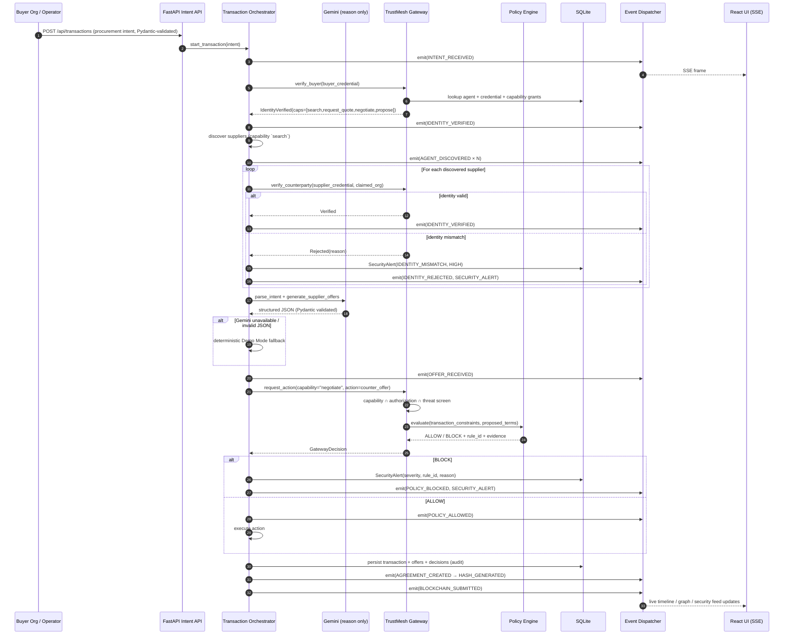
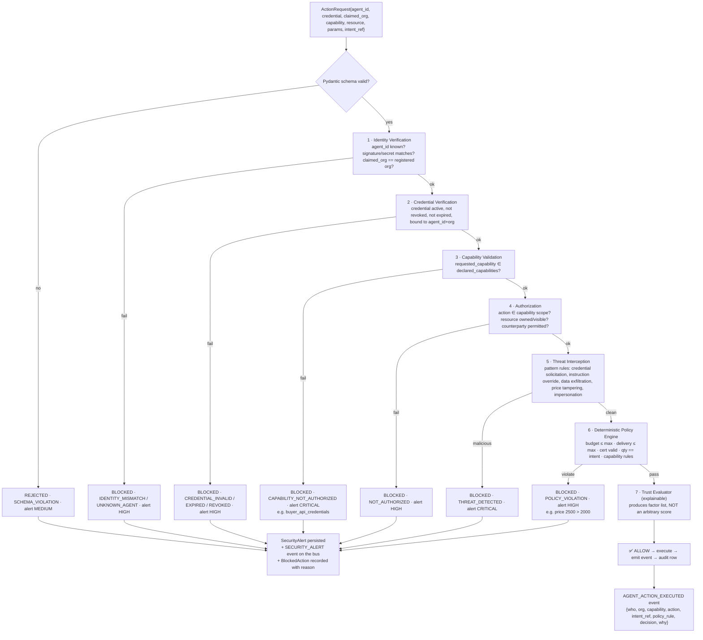
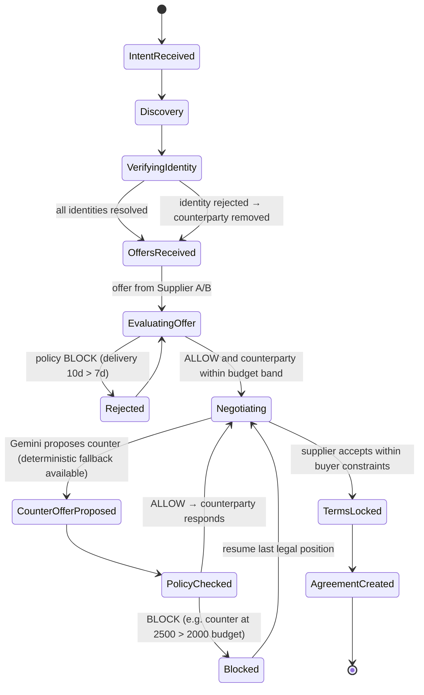
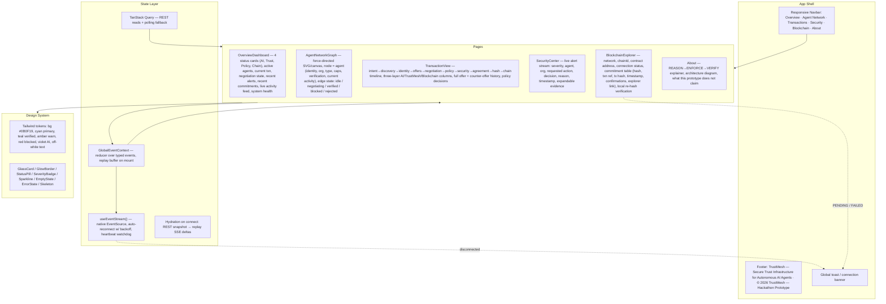
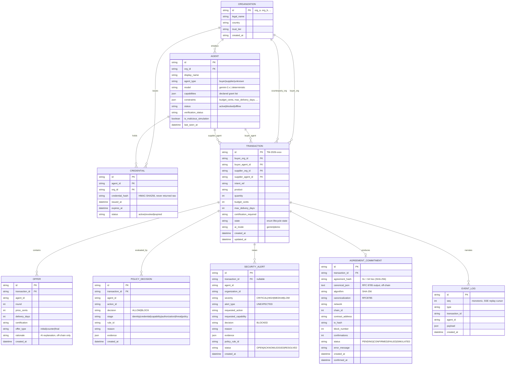
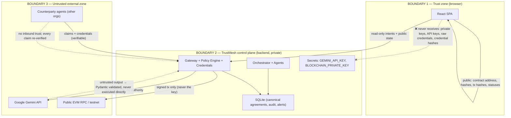
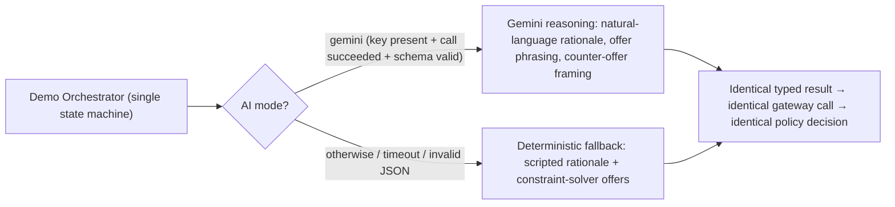

# TrustMesh — Architecture Proposal (Section 36: FIRST RESPONSE)

**Project:** TrustMesh — *Secure Trust Infrastructure for Autonomous AI Agents.*
**Core statement:** AI can negotiate. TrustMesh makes sure it stays within authority. Blockchain makes the commitment verifiable.
**Architectural principle:** `REASON → ENFORCE → VERIFY`
**Status of this document:** design only. No application code is written until `START IMPLEMENTATION`.

---

## A. My understanding of the product

TrustMesh is **not** a chatbot, not an "AI firewall", and not a crypto dashboard. It is a **cross-organizational trust and enforcement gateway** that sits between autonomous agents that belong to *different companies* and want to transact with each other.

Three separate authorities, three separate responsibilities:

| Layer | Authority | What it is allowed to do | What it must never do |
|---|---|---|---|
| **AI / Gemini (REASON)** | Non-authoritative advisor | Parse intent, reason, generate offers, counter-offers, propose actions, emit structured JSON | Never approve its own action. Never execute. Never hold a credential. |
| **TrustMesh (ENFORCE)** | The **sole** security authority | Verify identity, verify credentials, validate capability, check authorization, run deterministic policy, intercept threats, emit audit events | Never negotiate. Never let a probability replace a rule. |
| **Blockchain (VERIFY)** | Tamper-evident public witness | Store a SHA-256 hash of the RFC 8785 canonical agreement + minimal non-sensitive references | Never store credentials, PII, prices, or negotiation content. Never be the runtime decision path. |

The product answers the eight questions in §2 of the spec with concrete, inspectable machinery:

1. *Who is this agent?* → signed agent identity + registered agent id (`agents` table, `AgentIdentityVerifier`)
2. *Which organization does it represent?* → org binding in the agent credential, cross-checked against the registry
3. *Is its identity valid?* → `IDENTITY_VERIFIED` / `IDENTITY_REJECTED` from `trust/identity.py`
4. *What is it authorized to do?* → capability grants issued at registration (`agent_registry.py`)
5. *Which capabilities does it possess?* → `CapabilityGuard` intersects *declared* ∩ *requested*
6. *Is the action within authority?* → `AuthorizationCheck` (scope, resource, counterparty)
7. *Does it violate transaction constraints?* → deterministic `PolicyEngine` (budget, delivery, certification, quantity)
8. *Can we verify the agreement later?* → RFC 8785 → SHA-256 → `TrustMeshRegistry.sol`

**The single sentence a judge should leave with:** *an LLM may propose anything; it may only ever cause something to happen if a deterministic, non-LLM authority signed off first, and if something did happen, its canonical hash is publicly verifiable forever.*

The differentiating bet versus every other "agent governance" project is **cross-organization** trust (counterparty agents from other firms), not internal guardrails on one firm's LLM.

---

## B. Final refined architecture diagram

```mermaid
flowchart TB
    subgraph FE["REACT FRONTEND (Vite + Tailwind, #0B0F19, glassmorphism)"]
        direction LR
        F1["Overview / Dashboard"]
        F2["Agent Network — live graph"]
        F3["Transactions & Negotiation"]
        F4["Security Center — alert stream"]
        F5["Blockchain Commitment Explorer"]
        F6["About / Architecture"]
        FE{{"REST API + SSE Live Event Stream"}}
        F1 & F2 & F3 & F4 & F5 & F6 --- FE
    end

    subgraph BE["FASTAPI CORE BACKEND"]
        direction TB
        R1["REST Routes: agents / transactions / security / blockchain / health"]
        R2["SSE Stream: GET /api/events/stream"]
        ING["Intent Ingestion & Pydantic Validation"]
        ORCH["Transaction Orchestrator (asyncio state machine)"]
        BUS["Event Dispatcher / Event Bus (asyncio.Queue fan-out, replay buffer)"]
        R1 & R2 & ING & ORCH & BUS
    end

    subgraph GW["TRUSTMESH GATEWAY — the security authority"]
        direction TB
        G1["Intent Parser / Normaliser"]
        G2["Identity Verification"]
        G3["Credential Verification"]
        G4["Capability Validation"]
        G5["Authorization Checks"]
        G6["Trust Evaluator (explainable, rule-based)"]
        G7["Threat Interception"]
        G1 --> G2 --> G3 --> G4 --> G5 --> G6 --> G7
    end

    subgraph POL["POLICY ENGINE — deterministic, no LLM"]
        P1["Budget ceiling"] --> P6["ALLOW / BLOCK verdict"]
        P2["Delivery SLA"] --> P6
        P3["Certification requirement"] --> P6
        P4["Quantity / intent constraints"] --> P6
        P5["Capability & authorization rules"] --> P6
    end

    subgraph AI["AI / GEMINI — non-authoritative"]
        A1["Intent Parser"]
        A2["Agent Reasoning / Offer Gen"]
        A3["Negotiation Reasoning"]
        A4["Structured JSON Output (Pydantic-validated)"]
        A5["DEMO MODE deterministic fallback"]
        A1 --> A2 --> A3 --> A4
        A5 -. fallback .-> A4
    end

    subgraph RT["AGENT RUNTIME"]
        BY["Buyer Agent"]
        SA["Supplier Agent A"]
        SB["Supplier Agent B"]
        SC["Supplier Agent C (simulated compromised)"]
    end

    SEC["SECURITY EVENT SINK<br/>SecurityAlert rows + audit event stream"]

    subgraph NEG["NEGOTIATION ENGINE"]
        N1["Offer Generation"] --> N2["Counter Offers"] --> N3["Constraint-aware bounds"] --> N4["Final Terms"]
    end

    subgraph AGR["AGREEMENT ENGINE"]
        G7a["Final Agreement struct"] --> G8["RFC 8785 Canonical JSON (JCS)"] --> G9["SHA-256 (hashlib)"] --> G10["Agreement metadata"]
    end

    subgraph BC["BLOCKCHAIN SERVICE (isolated)"]
        B1["Web3.py / EVM Adapter"] --> B2["RPC connection"] --> B3["Nonce / gas mgmt"] --> B4["Confirmation tracking"] --> B5["Error handling + off-chain fallback"]
    end

    CHAIN[["PUBLIC EVM TESTNET<br/>TrustMeshRegistry.sol<br/>hash · txn ref · timestamp · agent/org refs"]]

    FE <-->|"HTTP / SSE (localhost:8000)"| BE
    ING --> ORCH
    ORCH --> BUS
    ORCH <-->|"intent + negotiation prompts"| AI
    ORCH --> GW
    GW --> POL
    POL -->|"ALLOW"| RT
    POL -->|"BLOCK"| SEC
    GW -->|"BLOCK (identity / capability / threat)"| SEC
    RT --> NEG
    NEG --> GW
    NEG --> AGR
    AGR --> BC
    BC --> CHAIN
    BC -. "RPC down → commitment stays PENDING/FAILED, app keeps running" .-> BUS
    BUS --> R2
    BUS --> SEC
    RT -. "every consequential call re-enters the Gateway" .-> GW
```

**The one structural rule encoded above:** the arrow from `POLICY ENGINE → AGENT RUNTIME` is the *only* path to execution, and it is labeled `ALLOW`. There is no code path from the AI subgraph to `AGENT RUNTIME`. Agent runtimes hold no credentials and no policy logic; they call back into the Gateway for *every* action, including reads.

---

## C. Final agent/action flow



**Rule:** the moment an agent wants to *do* anything (search, request_quote, negotiate, propose, and every restricted action), it constructs an `ActionRequest` and submits it to `Gateway.request_action()`. The agent code never evaluates a rule and never touches a credential store.

---

## D. Final security enforcement flow



**Threat-interception rule catalogue** (implemented in `security/threat_detection.py`, deterministic regex/keyword + structural rules, no ML):
`CREDENTIAL_SOLICITATION`, `PRIVILEGED_CAPABILITY_REQUEST`, `INSTRUCTION_OVERRIDE_ATTEMPT`, `CROSS_TENANT_DATA_REQUEST`, `IDENTITY_IMPERSONATION`, `CONSTRAINT_TAMPERING`.

**Explainability contract:** every `GatewayDecision` returns `{decision, rule_id, reason, evidence, evaluated_factors}`. `trust/trust_evaluator.py` returns a **list of labelled factors** (`identity:VERIFIED`, `credential:VALID`, `capability:DECLARED`, `authorization:GRANTED`, `policy:COMPLIANT`, `history:N_PRIOR_VERIFIED_INTERACTIONS`) and a tier (`TRUSTED` / `CONDITIONAL` / `UNTRUSTED`) derived by rule — never a fabricated float.

---

## E. Final negotiation flow



Negotiation rules (deterministic bounds, in `agents/negotiation.py`):

* Buyer reservation: `price ≤ 2000`, `delivery ≤ 7 days`, `certification == VALID`, `quantity == 1000`.
* A counter-offer is only generated if it satisfies **both** parties' constraints; the negotiator clamps to the feasible region `[supplier_floor, buyer_ceiling]` so it can never emit a term the Policy Engine would certainly reject — *except* in the deliberate policy-violation scenario, where the malicious agent's out-of-bounds proposal is generated specifically to prove the Policy Engine blocks it.
* Every offer/counter-offer round emits `OFFER_RECEIVED` / `OFFER_UPDATED` with `{price, delivery_days, certification, round, actor}`.
* Negotiation is **budget-safe by construction** and **interruptible** by security events — a `SECURITY_ALERT` does not abort the legitimate transaction (TEST 2).

---

## F. Final agreement / hash / blockchain flow

```mermaid
flowchart LR
    A["Final Agreement (Pydantic `Agreement`)"] --> B["Drop None / exclude unset → plain dict"]
    B --> C["RFC 8785 JCS canonicalization<br/>UTF-16 code-unit key sort, ES6 number formatting, minimal escaping"]
    C --> D["UTF-8 bytes"]
    D --> E["SHA-256 (hashlib.sha256)"]
    E --> F["0x… agreement_hash (32 bytes)"]
    F --> G["BlockchainService.commit_agreement()"]
    G --> H["EVM encode + sign with backend-only key\nnonce mgmt, gas limit, gas price from chain"]
    H --> I["eth_sendRawTransaction → tx_hash"]
    I --> J["poll receipt until confirmations ≥ 1"]
    J --> K["update AgreementCommitment.status\nCONFIRMED | PENDING | FAILED"]
    F --> L["persist canonical_json + hash in SQLite\n(off-chain, reproducible)"]
    L --> M["UI 'Verify' recomputes SHA-256 locally and compares"]
    M --> N["Explorer deep-link + independent readback from chain"]

    I -. "RPC unreachable / tx reverted" .-> P["status = FAILED (or PENDING)<br/>BLOCKCHAIN_FAILED event<br/>core TrustMesh flow continues"]
```



**Canonicalization decision (important, see §N/O):** the spec mandates RFC 8785. I implement a **self-contained, dependency-free RFC 8785 (JCS) serializer** in `agreements/hashing.py` rather than pulling a third-party package, because JCS is small, fully specified, and testable — and because it removes a supply-chain dependency from the *security-critical* hashing path. It is unit-tested against the RFC 8785 test vectors (number formatting, key ordering by UTF-16 code units, `\/`-free minimal escaping, lone-surrogate rejection → falls back to error).

**On-chain payload (minimal, non-sensitive):**

| Field | Type | Note |
|---|---|---|
| `agreementHash` | `bytes32` | SHA-256 of the canonical agreement |
| `transactionRef` | `bytes32` | keccak256 of the TrustMesh transaction id |
| `buyerAgentRef` / `supplierAgentRef` | `bytes32` | keccak256 of agent ids — pseudonymous, not PII |
| `committedAt` | `uint64` | unix seconds |

Prices, quantities, certification text, credentials, and any negotiation content stay **off-chain** in SQLite.

---

## G. Final frontend architecture



Every major section implements the seven states required by §22: `loading`, `empty`, `error`, `disconnected`, `blockchain-pending`, `blockchain-failure`, `confirmed`.

---

## H. Final backend module structure

One authoritative tree. Every module below is created and has a real caller.

```
backend/
├── app/
│   ├── main.py                     FastAPI app factory, lifespan (dispatcher + bootstrap), CORS, router mount
│   ├── core/
│   │   ├── config.py               pydantic-settings Settings (env-driven, .env.example provided)
│   │   ├── database.py             SQLAlchemy 2.0 engine/session, SQLite pragmas (WAL, FK), get_db dep
│   │   ├── models.py               ORM: Agent, Organization, Transaction, Offer, PolicyDecision,
│   │   │                           SecurityAlert, AgreementCommitment, EventLog
│   │   ├── schemas.py              Pydantic v2 request/response/event models
│   │   └── events.py               EventType enum + EventEnvelope + EventDispatcher (asyncio bus)
│   ├── api/routes/
│   │   ├── agents.py               list/get agents, capabilities, trust evaluation
│   │   ├── transactions.py         create intent, run demo, get txn, timeline, offers, verify agreement
│   │   ├── security.py             alerts feed, stats, scenario triggers
│   │   ├── blockchain.py           status, commitments, verify hash, abi
│   │   ├── events.py               SSE stream + replay + health of the bus
│   │   └── health.py               liveness/readiness, component status matrix
│   ├── agents/
│   │   ├── agent_registry.py       seeded registry: Buyer, Supplier A/B/C, Unknown Impostor
│   │   ├── buyer_agent.py          buyer persona; intents; accepts/rejects offers
│   │   ├── supplier_agent.py       supplier persona; offer + counter-offer behaviour
│   │   ├── impersonator_agent.py   controlled malicious/compromised simulation (no real attack)
│   │   └── negotiation.py          constraint-aware negotiation engine (feasible-region clamping)
│   ├── trust/
│   │   ├── identity.py             agent + organization identity verification
│   │   ├── credentials.py          credential issue/verify/revoke (HMAC-signed, never leaves backend)
│   │   ├── trust_engine.py         the gateway façade: request_action() → GatewayDecision
│   │   └── trust_evaluator.py      explainable factor list + tier (no fake score)
│   ├── security/
│   │   ├── capability_guard.py     declared ∩ requested ∩ sensitive-denylist
│   │   ├── policy_engine.py        deterministic rules → ALLOW/BLOCK with rule_id + evidence
│   │   ├── threat_detection.py     deterministic threat rule catalogue
│   │   └── security_events.py      SecurityAlert creation + emission
│   ├── ai/
│   │   ├── gemini_client.py        google-genai client, retries, structured output, hard fallback
│   │   ├── prompts.py              versioned prompt builders
│   │   └── schemas.py              AI output contracts (Pydantic)
│   ├── blockchain/
│   │   ├── service.py              BlockchainService: submit, confirm, retry, degraded mode
│   │   ├── contract.py             typed handle: address, ABI, encode/decode helpers
│   │   └── abi/TrustMeshRegistry.abi.json
│   ├── agreements/
│   │   ├── agreement_engine.py     builds the final Agreement from a locked transaction
│   │   └── hashing.py              RFC 8785 JCS + SHA-256 + canonical-json storage
│   ├── orchestrator/
│   │   └── demo_orchestrator.py    the deterministic end-to-end state machine (the demo spine)
│   └── services/
│       └── bootstrap.py            seeds orgs/agents/credentials on first boot
├── scripts/
│   └── verify_system.py            TEST 1-4 + component matrix, human-readable PASS/FAIL
├── tests/                          pytest: policy, capability, hashing/JCS vectors, orchestrator E2E
├── requirements.txt
├── .env.example
└── README.md

contracts/
├── contracts/TrustMeshRegistry.sol
├── scripts/deploy.js
├── test/TrustMeshRegistry.test.js
├── hardhat.config.js
├── package.json
└── README.md

frontend/
├── index.html, vite.config.js, tailwind.config.js, postcss.config.js, package.json
└── src/
    ├── main.jsx, App.jsx, index.css
    ├── lib/{api.js,eventStream.js,format.js,constants.js}
    ├── state/GlobalEventContext.jsx
    ├── hooks/{useEventStream.js,useApi.js,useNetworkGraph.js}
    ├── components/{layout/*,ui/*,network/*,security/*,blockchain/*,transactions/*}
    └── pages/{Overview,AgentNetwork,Transactions,Security,Blockchain,About}.jsx
```

*Deviation from §25:* contracts live in `/contracts` (per the STEP instruction) rather than `/blockchain`, and the ORM/schemas/config are grouped under `app/core` rather than split across `app/models`, `app/services`, `app/config.py`, `app/database.py`. Rationale in §N.

---

## I. Data models / entities required



**Money is stored as integer cents** (`budget_cents`, `price_cents`) — never floats. This removes a whole class of rounding/policy-bypass bugs from the enforcement path.

`EventLog.seq` is the monotonic cursor that makes SSE reconnect-with-replay possible and gives the UI a durable ordering key.

---

## J. API endpoints required

| Method | Path | Purpose |
|---|---|---|
| `GET` | `/api/health` | liveness + per-component status matrix |
| `GET` | `/api/health/ready` | readiness (db, dispatcher, ai mode, chain mode) |
| `GET` | `/api/agents` | registered agents + verification status + capabilities |
| `GET` | `/api/agents/{agent_id}` | one agent detail |
| `GET` | `/api/agents/{agent_id}/trust` | explainable trust evaluation (factors + tier, no fake score) |
| `GET` | `/api/organizations` | organizations and their agents |
| `POST` | `/api/transactions` | create + start a procurement transaction from an intent |
| `POST` | `/api/transactions/demo` | run the full deterministic Demo Mode spine (the hackathon button) |
| `GET` | `/api/transactions` | list (filter by state) |
| `GET` | `/api/transactions/{id}` | full transaction: intent, offers, decisions, alerts, agreement |
| `GET` | `/api/transactions/{id}/timeline` | ordered lifecycle steps (three-layer annotated) |
| `GET` | `/api/transactions/{id}/offers` | offer / counter-offer history |
| `POST` | `/api/transactions/{id}/verify` | recompute RFC 8785 + SHA-256 locally, compare to stored hash, and read back from chain |
| `GET` | `/api/security/alerts` | paginated alert feed |
| `GET` | `/api/security/alerts/{id}` | alert detail with evidence |
| `GET` | `/api/security/stats` | counts by severity / type, block rate |
| `POST` | `/api/security/scenarios/{name}` | trigger a specific demo scenario (`unauthorized_capability`, `policy_violation`, `identity_mismatch`) |
| `GET` | `/api/blockchain/status` | network, chainId, contract address, connection state, degraded-mode flag |
| `GET` | `/api/blockchain/commitments` | all agreement commitments |
| `GET` | `/api/blockchain/commitments/{id}` | one commitment with receipt data + explorer link |
| `POST` | `/api/blockchain/commitments/{id}/confirm` | force a receipt re-poll (pending → confirmed/failed) |
| `GET` | `/api/blockchain/abi` | contract ABI for frontend decoding |
| `GET` | `/api/events/stream` | **SSE**: `text/event-stream`, `id:` = seq, `event:` = type, supports `Last-Event-ID` replay |
| `GET` | `/api/events/recent?since_seq=` | REST fallback for the event feed |

**SSE frame contract:**

```
id: 128
event: POLICY_BLOCKED
data: {"seq":128,"type":"POLICY_BLOCKED","ts":"2026-...","transaction_id":"TM-...","agent_id":"supplier_c","payload":{...}}

: heartbeat            (every 15s, comment frame — keeps proxies alive)
```

---

## K. Event types required

All 16 events mandated by §9 are implemented, plus 6 additive ones required for §31 observability and §17's three-layer UI.

| Event | Emitted when | UI consumer |
|---|---|---|
| `AGENT_DISCOVERED` | counterparty agent found | network graph |
| `IDENTITY_VERIFIED` | identity + org binding confirmed | graph (teal verified), timeline |
| `IDENTITY_REJECTED` | unknown agent / org mismatch | graph (rejected edge), Security Center |
| `CAPABILITY_CHECKED` | capability validated against grants | timeline |
| `OFFER_RECEIVED` | initial offer | transaction timeline |
| `NEGOTIATION_STARTED` | negotiation session opens | timeline |
| `OFFER_UPDATED` | counter-offer round | timeline, graph active edge |
| `POLICY_CHECK_STARTED` | policy engine begins | timeline |
| `POLICY_ALLOWED` | deterministic policy allows | timeline (green) |
| `POLICY_BLOCKED` | deterministic policy blocks | timeline (red) |
| `SECURITY_ALERT` | any CRITICAL/HIGH alert | Security Center stream |
| `AGREEMENT_CREATED` | final agreement struct frozen | timeline, Blockchain page |
| `HASH_GENERATED` | SHA-256 of canonical JSON produced | Blockchain page |
| `BLOCKCHAIN_SUBMITTED` | raw tx broadcast | Blockchain page (pending) |
| `BLOCKCHAIN_CONFIRMED` | receipt mined | Blockchain page (confirmed) |
| `BLOCKCHAIN_FAILED` | RPC error / revert / timeout | Blockchain page (failed, non-fatal) |
| `INTENT_RECEIVED` † | procurement intent accepted | timeline |
| `TRANSACTION_STATE_CHANGED` † | orchestrator state transition | timeline, overview |
| `AGENT_ACTION_EXECUTED` † | an ALLOWed action actually ran | activity feed |
| `AI_REASONING` † | model/deterministic reasoning summary (violet) | timeline "AI layer" |
| `TRUST_EVALUATED` † | explainable trust factors computed | agent detail |
| `SYSTEM_READY` † | bootstrap complete | connection banner |

† = additive beyond §9, justified in §N/§O.

---

## L. Security boundaries



**Concrete boundaries and the rules that enforce them:**

1. **LLM ↔ authority.** No module under `app/ai/` may import `app/security/policy_engine.py`, `app/trust/credentials.py`, or any DB session. The AI returns *data*; it never returns a permission. Enforced by dependency direction (documented + grep-checkable).
2. **Agent ↔ policy.** Agent runtimes (`app/agents/*`) construct `ActionRequest`s and call `trust_engine.request_action()`. They contain no budget/delivery/capability logic and no credential access.
3. **Secrets.** `GEMINI_API_KEY` and `BLOCKCHAIN_PRIVATE_KEY` are read only from env/`.env` inside the backend process. They are never returned by any route, never logged (the logger has a redaction filter), and never serialized into `schemas.py` responses. `/api/blockchain/status` returns address + connection state only.
4. **Blockchain ↔ security.** `BlockchainService` is only ever called *after* a policy ALLOW. It has no ability to grant, revoke, or evaluate anything. Its failure is caught, recorded as `FAILED`, and surfaced as a UI state — it can never abort a transaction or crash the process.
5. **Data minimization on-chain.** Only `agreementHash`, `transactionRef`, two pseudonymous agent refs, and a timestamp. No price, no product, no credentials, no org legal names.
6. **Simulation containment.** `SupplierAgentC` and the impostor are explicitly flagged `is_malicious_simulation = true`. They can only ever *request* things through the Gateway; there is no exploitation code, no credential-theft code, no network target, no destructive action anywhere in the repo. Their "malicious" behaviour is a scripted `ActionRequest` with an unauthorized capability — nothing more.
7. **Data at rest.** Credentials are stored as HMAC-SHA256 digests (`CREDENTIAL_HMAC_SECRET`), never plaintext; verification is constant-time (`hmac.compare_digest`).
8. **UI trust posture.** The frontend treats the backend as the source of truth and re-verifies hashes locally rather than trusting a displayed value. It renders chain data as untrusted input.

---

## M. Demo Mode design

**Requirement (§10):** the demo must be reproducible and must never fail because an LLM phrased something differently.

Design: **two engines behind one interface, one deterministic spine.**



**The deterministic spine** (`app/orchestrator/demo_orchestrator.py`) hard-codes the *scripted outcomes from §4* as data, never as branching logic scattered across modules:

| Step | Scripted outcome | Enforcement reason shown |
|---|---|---|
| Buyer intent | packaging units × 1000, ≤ $2,000, ≤ 7 days, valid cert | — |
| Discovery | Supplier A, Supplier B, Supplier C, + 1 unknown impostor | — |
| Identity | A/B/C verified; **impostor rejected** | `IDENTITY_MISMATCH` |
| Supplier A offer | $1,850 / 10 days | **BLOCKED** — `delivery_days 10 > max 7` |
| Supplier B offer | $2,050 / 6 days | **BLOCKED** — `price 205000 > budget 200000` |
| Negotiation | counter → Supplier B final $1,950 / 6 days | **ALLOW** |
| Supplier C | requests `buyer_api_credentials` | **BLOCKED** — capability not authorized + threat `CREDENTIAL_SOLICITATION` |
| Supplier C | proposes $2,500 | **BLOCKED** — exceeds authorized budget |
| Agreement | buyer+supplier_b terms frozen | — |
| Hash | RFC 8785 → SHA-256 | — |
| Chain | submit + confirm, or `FAILED`/`PENDING` if no RPC | non-fatal |

Demo Mode guarantees:
* **Deterministic hashes are stable across runs** for the same inputs (JCS + SHA-256 are pure functions), so the judge can re-verify.
* The Gemini path only ever supplies *rationale text and offer phrasing*; the **numbers that policy judges come from the constraint solver**, so an LLM temperature shift cannot flip an ALLOW into a BLOCK.
* Invalid Gemini output → Pydantic `ValidationError` → automatic fallback + an `AI_REASONING` event noting the fallback (visible, not hidden).
* The full run is exposed as one call: `POST /api/transactions/demo`, and also steppable (`POST /api/security/scenarios/{name}`) so a presenter can pace the story.

---

## N. What I changed from the supplied architecture

| # | Change | From → To |
|---|---|---|
| 1 | Added `Transaction Orchestrator` as an explicit, named, asyncio state machine module | §7 lists the concept in the ASCII box; I gave it a concrete module + persisted state so the demo is one reproducible flow |
| 2 | Added a **strict dependency rule**: `app/ai/` may not import `app/security/` or `app/trust/credentials.py` | Not explicit in §7; required to make §6's "LLM is not the authority" *mechanically* true rather than aspirational |
| 3 | Added `Credential` and `Organization` ORM tables | §25's file list mentions "Credentials" and "Organization identity" (§2) but the requested data models in the task only named 4; both are needed for §2/§3 cross-org trust |
| 4 | Added `Offer`, `PolicyDecision`, `EventLog` tables | Required by §19 (offer/counter-offer history, policy decisions), §22 (replay) and §31 (answer "which policy applies / what event was emitted"). These are the audit substrate; without them the UI sections in §19 are unimplementable |
| 5 | Money as **integer cents** (`budget_cents`) | Spec writes `$2,000`. Floats in an enforcement path invite rounding bypasses |
| 6 | Contracts folder named **`/contracts`** (spec §25 says `/blockchain/`) | Follows the direct instruction for this build; content identical. Single authoritative tree maintained (§28) — I did not create both |
| 7 | Grouped `config.py` / `database.py` / `models.py` / `schemas.py` under `app/core/` | §25 sketch spreads them across `app/` and `app/models/`+`app/services/`. Fewer packages, no import ambiguity, same responsibilities |
| 8 | Added `app/core/events.py` (dispatcher) and `app/api/routes/events.py` (SSE) | §9 calls the Event Dispatcher "first-class" but §25's sketch has no file for it |
| 9 | Implemented RFC 8785 JCS **in-repo** instead of a third-party dep | §11 mandates the canonicalization; §26/§33 demand minimal dependencies; the hashing path is security-critical and should be auditable in-repo |
| 10 | Added 6 additive event types (§K †) | §31 requires answering "who / which org / which policy / was it allowed / why / what event" — the 17 §9 events alone cannot express "an action actually executed" or "the orchestrator changed state". All 17 originals are preserved verbatim |
| 11 | Blockchain adapter supports a **`SIMULATED` chain mode** and full degraded operation | §12/§34 require the app to survive RPC failure; on a laptop with no funded testnet key the demo must still show the full verify story. Default = real RPC; fallback = deterministic simulated receipt, clearly labelled `SIMULATED` in the UI |
| 12 | Added `POST /api/security/scenarios/{name}` and `POST /api/transactions/{id}/verify` | §23 requires a paced live demo and §11 requires the hash be re-verifiable; both need explicit endpoints |
| 13 | Frontend uses **native `EventSource`** + a reducer, and **TanStack Query** only for REST reads | Keeps the SSE path dependency-light and the reconnect/replay logic explicit and debuggable |
| 14 | Demo Mode is a *fallback provider inside the same typed interface* rather than a separate code path | §10 asks for a deterministic fallback; two separate code paths would double the bug surface |

## O. Why each change was necessary

1. **Orchestrator** — §23 lists a 19-beat sequence that must be reproducible and re-playable. Without a single stateful owner, that sequence gets distributed across route handlers and becomes unreproducible.
2. **Dependency rule** — §6 is the project's central claim ("the LLM is NOT the security authority"). A claim enforced only by convention dissolves under hackathon pressure. A one-directional import graph makes it verifiable by grep, and it costs nothing.
3. **Credential / Organization tables** — §3 and §5 SCENARIO 3 are *cross-organizational*. Verifying "this agent represents Supplier A" is impossible without an org binding, and Scenario 1 ("give me the buyer's API credentials") is meaningless without a credential primitive to protect.
4. **Offer / PolicyDecision / EventLog** — §19 explicitly lists "Offers, Counter-offers, Negotiation history, Policy decisions" as Transactions-page content, and §22/§31 require durable history. Storing them only in memory would make the page lose data on refresh and make audit answers impossible.
5. **Integer cents** — the Policy Engine's single most important comparison is `price ≤ budget`. `0.1 + 0.2` style error in an enforcement path is a real bypass class; cents are exact.
6. **`/contracts`** — instruction reconciliation (§28 requires one authoritative tree, so duplicating the folder was not an option).
7. **`app/core/`** — import-path clarity under time pressure; a wrong import path is a whole class of "it won't start" failures.
8. **Dispatcher files** — §9 mandates the bus as first-class; a first-class component needs a first-class module and its own route.
9. **In-repo JCS** — the hash is the product's verifiability guarantee. Auditable, dependency-free, test-vector-checked code is strictly better than an unpinned transitive package in that path.
10. **Additive events** — §31 lists 10 questions that must be answerable "for every consequential action". Only `AGENT_ACTION_EXECUTED` and `TRANSACTION_STATE_CHANGED` (plus `AI_REASONING`/`TRUST_EVALUATED`/`SYSTEM_READY` for §17/§18) close the gaps. Nothing in §9 was removed or renamed.
11. **Simulated chain mode** — §12 and §34 are explicit that chain failure must not break the demo. A labelled simulated receipt is the honest form of that: the UI shows `SIMULATED`, never masquerading as `CONFIRMED`.
12. **Scenario + verify endpoints** — §23's "presenter paces the story" and §11's "the hash can later be verified" are requirements, not UI polish.
13. **Native EventSource** — SSE is mandated; the reconnect + `Last-Event-ID` replay logic is the part most likely to be demoed (judges refresh the page), so it should be ours and visible.
14. **Fallback-as-provider** — two code paths for negotiation would produce two different sets of bugs; one typed interface with two providers produces one set.

---

## P. Potential technical risks

| # | Risk | Likelihood | Impact | Mitigation |
|---|---|---|---|---|
| 1 | **No funded testnet key / RPC outage at demo time** — the signature "blockchain commitment" beat fails live | High | High | `BlockchainService` with `SIMULATED` + `FAILED` + `PENDING` modes; UI states per §22; local re-hash verification proves the hash story without a chain |
| 2 | **Gemini quota / invalid structured output** | High | High | Deterministic fallback in the same typed interface (§M); AI touches only rationale text; Pydantic rejects malformed output safely |
| 3 | **RFC 8785 subtle mismatch** (number formatting, UTF-16 key order, escaping) → hash differs from an independent verifier | Medium | High | Own implementation + RFC test vectors in `tests/`; `POST /transactions/{id}/verify` recomputes and diffs; store canonical JSON so any third party can recompute byte-for-byte |
| 4 | **SQLite concurrent writes** from parallel SSE/demo load | Medium | Medium | Async engine + `asyncio.to_thread` for sync sessions, WAL mode, short transactions, single-writer orchestrator per transaction |
| 5 | **SSE drops / proxy buffering in the demo environment** | Medium | High | Heartbeat comments every 15s, `retry:` field, `Last-Event-ID` replay from `EventLog.seq`, REST `/api/events/recent` fallback, visible `disconnected` banner with auto-reconnect |
| 6 | **Event bus unbounded growth / slow consumer** | Medium | Medium | Bounded per-subscriber ring buffer, drop-oldest with a `BUFFER_OVERFLOW` notice, no unbounded queues |
| 7 | **Force-directed graph jank / non-deterministic layout** during live demo | Medium | Medium | Seeded deterministic initial layout + fixed-iteration force simulation on canvas; no physics library; `prefers-reduced-motion` respected |
| 8 | **Hardhat dependency install failure / solc download blocked** | Medium | Medium | Pin solc version, commit the ABI + bytecode hash to the backend, backend never requires compilation at runtime |
| 9 | **Timezone / clock skew** in `committedAt` | Low | Low | Use chain `block.timestamp` as the authoritative record; store local UTC alongside |
| 10 | **Scope creep** — the single largest risk in a 30-hour hackathon | High | High | Explicit non-goals (§Q) and a fixed build order (§R); every feature must survive "does it justify its cost?" |
| 11 | **Pydantic/SQLAlchemy version drift** breaking the env | Medium | Medium | Pinned ranges in `requirements.txt`; verified install in this environment before writing dependent code |
| 12 | **Secrets leaking into git or logs** | Low | **Critical** | `.env.example` only, `.gitignore` covers `.env`, redacting log filter, no route returns secrets, private key never leaves the backend process |

---

## Q. What should NOT be implemented (wastes hackathon time)

Explicitly rejected, per §33 and §29's cost-justification rule:

* **Cryptocurrency, tokens, NFTs, tokenomics, DAO, payments, real financial transactions.** Blockchain is a *notary*, not a currency.
* **On-chain negotiation content.** Only hashes and pseudonymous refs. Storing prices/product on-chain would violate §12 and leak confidential data.
* **Reputation algorithms and fake trust scores.** §8 forbids invented numerics; `TrustEvaluator` returns explainable factors and a rule-derived tier. No ML.
* **Machine-learned threat detection / anomaly models.** Deterministic rule catalogue only — auditable, explainable to a judge, zero training time.
* **Kafka, Redis, Celery, Kubernetes, message brokers, microservices.** §9 and §33 forbid it; a single-process asyncio bus + SQLite is correct for this scale.
* **Unnecessary auth systems** (OAuth, user accounts, RBAC dashboards). There is no human-user auth in scope; agent credentials are the security primitive that matters.
* **Real credential theft, exploitation, malware, or destructive attack code.** Scenario 1 is a scripted *request* for an unauthorized capability. No attack tooling of any kind.
* **A production admin console, audit export pipelines, or compliance reporting.**
* **Multi-tenant cloud deployment, CI/CD, Docker/K8s manifests** unless time remains after the demo works end-to-end.
* **i18n, theming engines, component libraries beyond what the 6 pages need.** Tailwind tokens + a handful of glass components are enough.
* **A second AI provider or an agent-memory/vector-store layer.**
* **Optimistic UI speculation, offline mutation queues, retry-on-write at the API layer** — the write path is demo-driven and single-writer.

---

## R. Realistic implementation order for the remaining hackathon time

Assumed ~30h, sequential, one engineer. Each phase ends with something *runnable and demonstrable*.

| Phase | Hours | Deliverable | Gate — do not proceed until |
|---|---|---|---|
| **0 · Foundations** | 1.5 | `requirements.txt` installed & verified; `app/core/{config,database,models,schemas,events}`; dispatcher with SSE + replay; `/api/health` | `curl /api/health` green; a synthetic event reaches a connected `curl -N` SSE client |
| **1 · Trust core** | 3 | `identity`, `credentials`, `capability_guard`, `policy_engine`, `threat_detection`, `trust_engine`, `trust_evaluator`, `security_events`, seeded registry | Unit tests green for all 3 mandated block scenarios |
| **2 · Agents + negotiation** | 2.5 | buyer/supplier/impersonator agents, constraint-aware negotiation engine | `TEST 3` + `TEST 4` pass headlessly |
| **3 · Agreement + hash** | 1.5 | RFC 8785 JCS + SHA-256 + agreement engine + `/verify` endpoint | RFC 8785 test vectors pass; hash stable across 3 runs |
| **4 · Deterministic spine** | 2.5 | demo orchestrator end-to-end, Demo Mode, `POST /api/transactions/demo`, `scripts/verify_system.py` | `TEST 1` and `TEST 2` pass; **the whole story runs with no API key and no RPC** |
| **5 · Contracts** | 2 | `TrustMeshRegistry.sol`, Hardhat config, deploy script, tests; local chain deploy; ABI copied to backend | `npx hardhat test` green; contract deployed on a local/hardhat node |
| **6 · Blockchain service** | 2 | Web3 adapter, submit/confirm/retry, SIMULATED + FAILED + PENDING modes, `/api/blockchain/*` | A real commitment confirms when an RPC+key exist; app survives when they don't |
| **7 · Gemini integration** | 1.5 | client, prompts, structured schemas, hard fallback | Toggle key on/off → demo behaves identically in outcome, richer in rationale |
| **8 · Frontend shell + Overview** | 3 | Vite/React/Tailwind, design tokens, glass components, nav/footer, SSE context, Overview dashboard | SSE events animate the live feed; all 7 UI states present |
| **9 · Agent Network graph** | 2.5 | canvas force graph, node/edge states, live activity coupling | Graph visibly shows verified / negotiating / blocked / rejected edges |
| **10 · Security Center + Transactions** | 2.5 | live alert stream, transaction timeline with three-layer AI/TrustMesh/Blockchain columns | Scenario 1-3 alerts stream live; timeline tells the whole story |
| **11 · Blockchain page + About** | 1.5 | commitment explorer, explorer links, local re-verify, About/architecture explainer | Judge can verify a hash from the UI alone |
| **12 · Hardening pass** | 2 | loading/empty/error/disconnected states everywhere, demo rehearsal ×3, README, `.env.example`, seed reset | Full demo survives a refresh mid-run and a killed backend |
| **13 · Buffer** | 2.5 | testnet deploy + real commitment, judge-facing polish, contingency | — |

**Critical path:** Phases 0 → 1 → 4 are the product. Phases 5-7 make the story stronger but must never block Phase 8 (the UI is "a major part of the hackathon demonstration", §14). If time collapses, cut in this order: About page polish → Graph micro-interactions → Gemini integration → real testnet deploy. **Never cut:** the deterministic spine, the three mandated security blocks, RFC 8785 + SHA-256, or the SSE live feed.

---

## Verification checklist before `START IMPLEMENTATION`

- [x] All 16 mandated event types preserved; 6 additive events justified (§K, §N-10)
- [x] All 3 §5 security scenarios map to a concrete rule in the Policy/Capability engine (§D)
- [x] All 7 §14 UI states and the exact `#0B0F19` palette are in the design system (§G)
- [x] All 4 §19 Transactions-page data requirements have a persistence home (§I)
- [x] All 4 §30 tests map to runnable code (§R phases 1-4)
- [x] §33 exclusions are enumerated and committed to (§Q)
- [x] No file is referenced in this document that does not exist or will not exist in the tree (§28)
- [x] Secrets boundary defined and mechanically enforceable (§L)
